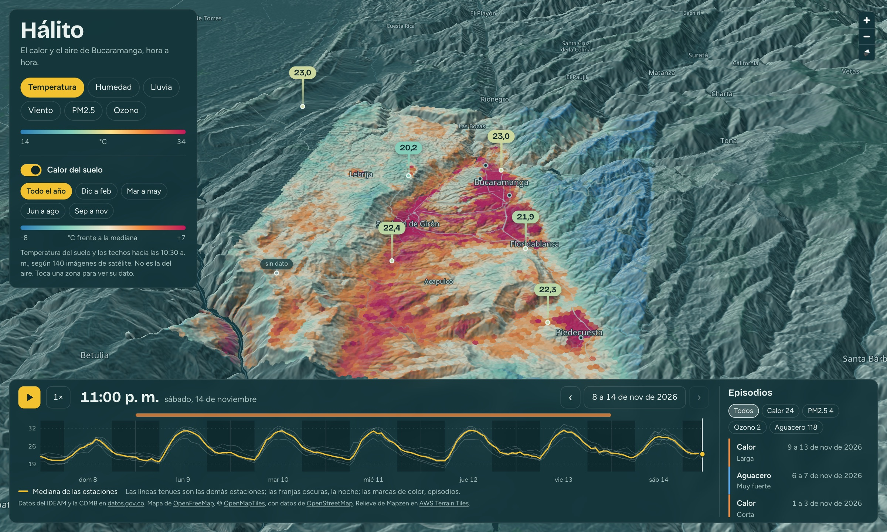
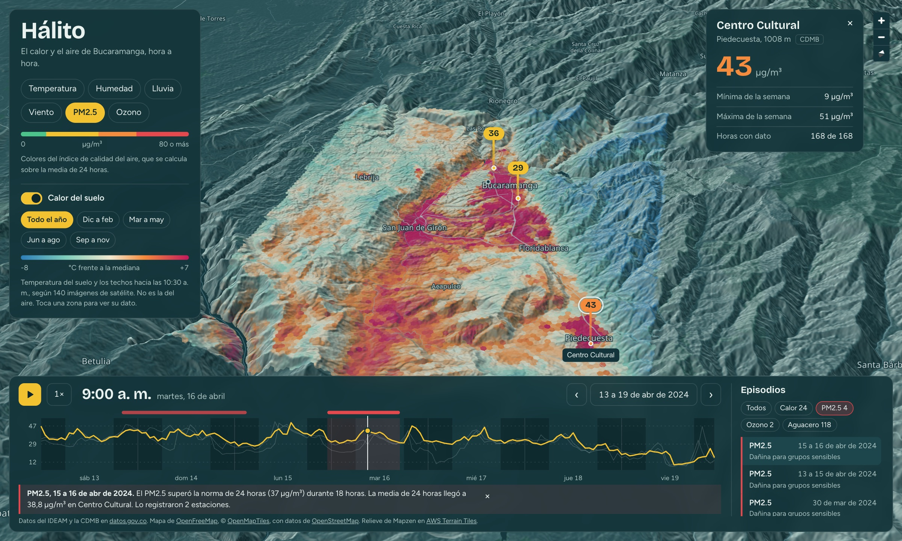
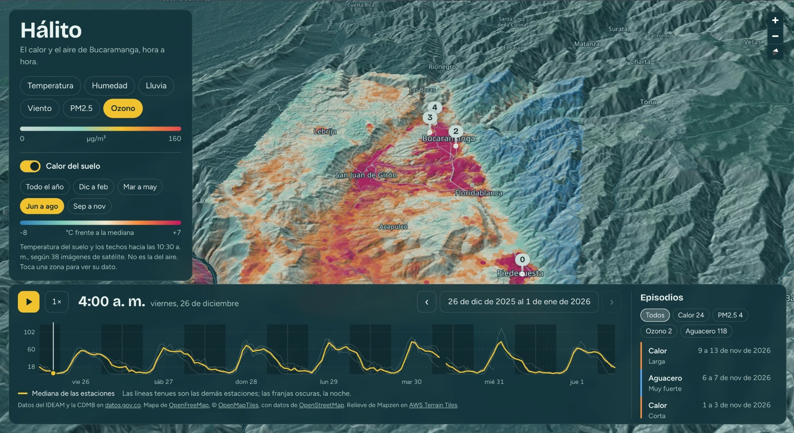
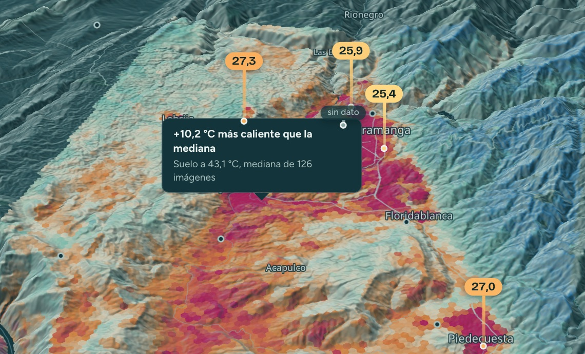
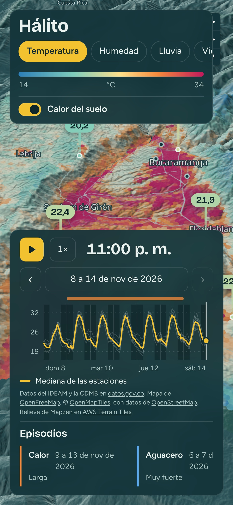

# Hálito

**El calor y el aire de Bucaramanga, hora a hora, sobre el relieve.**



## Qué es

Hálito es una aplicación web que reúne en un mismo mapa los datos públicos de clima, calidad del
aire y temperatura del suelo del área metropolitana de Bucaramanga (Bucaramanga, Floridablanca,
Girón, Piedecuesta y Lebrija).

Toma las mediciones de 12 estaciones del **IDEAM** y de la **CDMB**, publicadas en
[datos.gov.co](https://www.datos.gov.co), y 140 imágenes del satélite **Landsat**. Las limpia,
las guarda en una base de datos de series de tiempo y las muestra sobre un mapa 3D del relieve,
con una línea de tiempo que se puede reproducir hora a hora.

Responde tres preguntas:

- **¿Qué zonas se calientan más?** El satélite muestra las islas de calor barrio por barrio.
- **¿Qué pasó en un episodio de calor o contaminación?** Dónde empezó, cuánto duró y en qué
  estación llegó a su pico.
- **¿Cómo se comparan las estaciones?** Todas se ven a la vez, hora a hora.

El nombre viene de *hálito*: aliento, el aire que se respira.

## Qué se puede hacer

- **Reproducir cualquier semana desde enero de 2024.** Las estaciones suben y bajan con el valor
  de cada hora, y la línea de tiempo es a la vez la gráfica de la semana.
- **Cambiar de variable**: temperatura, humedad, lluvia, viento, PM2.5 y ozono, cada una con su
  escala de color.
- **Ver las islas de calor.** 8.566 hexágonos de unos 0,1 km² muestran cuánto más caliente o
  fresco está el suelo que la mediana del área, por época del año.
- **Abrir un episodio** (ola de calor, PM2.5 por encima de la norma, ozono o aguacero) y saltar
  a su semana, su hora pico y su estación, con un resumen escrito a partir de los datos.
- **Tocar una estación o una zona** para ver su dato, sus mínimos y máximos de la semana.





| Una zona del mapa de calor | En el teléfono |
|---|---|
|  |  |

## En cifras

| | |
|---|---|
| Observaciones horarias limpias | 1,48 millones (12 estaciones, ene-2024 → nov-2026) |
| Horas rechazadas por calidad | 90.880, guardadas con su valor crudo |
| Imágenes Landsat procesadas | 248, de las que 140 sirven (el resto, nubes) |
| Celdas de calor | 8.566 hexágonos H3, cada uno con 10 a 135 imágenes |
| Episodios detectados | 148: 24 de calor, 4 de PM2.5, 2 de ozono y 118 aguaceros |
| Tests | 62, unitarios y de integración contra PostgreSQL real |

## Tecnologías

### Datos y backend

| Tecnología | Versión | Para qué |
|---|---|---|
| Python | 3.12 | Lenguaje de la ingesta, el análisis y la API |
| [Polars](https://pola.rs) | 2.1 | Limpieza y agregación horaria de millones de lecturas |
| [FastAPI](https://fastapi.tiangolo.com) + Uvicorn | 0.163 | API de solo lectura, con documentación OpenAPI automática |
| SQLAlchemy + psycopg | 2.1 / 3.3 | Acceso a la base, síncrono para la ingesta y asíncrono para la API |
| Alembic | 1.20 | Migraciones del esquema, escritas en SQL explícito |
| httpx | 0.28 | Cliente de la API de datos.gov.co (Socrata), con reintentos |
| Typer | 0.29 | Comandos de ingesta y mantenimiento (`halito --help`) |
| rasterio + NumPy | 1.5 / 2.5 | Lectura y procesamiento de las imágenes Landsat |
| pystac-client + planetary-computer | 0.9 / 1.0 | Búsqueda y descarga de escenas en Microsoft Planetary Computer |
| [H3](https://h3geo.org) | 4.5 | Rejilla de hexágonos para resumir el calor del suelo |
| pytest, Ruff y mypy (estricto) | | Tests, estilo y tipos |

### Base de datos

| Tecnología | Versión | Para qué |
|---|---|---|
| PostgreSQL | 16 | Base de datos principal |
| [TimescaleDB](https://www.timescale.com) | 2.32 | Series de tiempo: tabla particionada por mes y resumen diario continuo |
| [PostGIS](https://postgis.net) | 3.7 | Ubicación de las estaciones y cálculos geográficos |

### Interfaz

| Tecnología | Versión | Para qué |
|---|---|---|
| [Vue](https://vuejs.org) + TypeScript | 3.5 / 6.0 | Aplicación y estado de la interfaz |
| [MapLibre GL JS](https://maplibre.org) | 5.24 | Mapa 3D con relieve, estaciones y capa de calor |
| h3-js | 4.5 | Dibuja los hexágonos de calor en el mapa |
| Vite | 8.3 | Servidor de desarrollo y compilación |
| SVG propio | | Línea de tiempo y gráfica de la semana, sin librerías de gráficos |

### Despliegue

| Tecnología | Para qué |
|---|---|
| Docker y Docker Compose | Todo el sistema en contenedores, igual en local y en el servidor |
| [Caddy](https://caddyserver.com) 2.10 | Sirve la web, reenvía `/api` a la API y obtiene el certificado HTTPS solo |
| GitHub Actions | Lint, tipos, tests contra una base real y construcción de las imágenes |

## Cómo está hecho

```
datos.gov.co (IDEAM, CDMB)        Planetary Computer (Landsat 8/9)
          │                                   │
          ▼                                   ▼
   ingesta incremental               ventana del área → °C → nubes fuera
   limpieza y agregación horaria     anomalía por escena → hexágonos H3
          │                                   │
          └──────────────► PostgreSQL ◄───────┘
                    PostGIS + TimescaleDB
                            │
              detección de episodios (SQL + Python)
                            │
                     API FastAPI (solo lectura)
                            │
              Vue 3 + MapLibre GL (relieve 3D)
```

1. **Ingesta.** Cada día se piden a datos.gov.co solo las lecturas nuevas de cada estación. Se
   guardan con su valor crudo, se descartan las que están fuera de rango y se resumen por hora.
2. **Calor del suelo.** De cada imagen Landsat se lee solo la ventana del área metropolitana, se
   quitan nubes y sombras, y se calcula cuánto más caliente está cada hexágono que la mediana de
   esa imagen. Con todas las imágenes se publica la mediana por hexágono y por época del año.
3. **Episodios.** Reglas en SQL detectan las horas o los días por encima de cada umbral; luego se
   unen las estaciones que coinciden en el tiempo y se escribe un resumen con los números.
4. **API e interfaz.** La API entrega los datos en columnas, listos para animar una semana entera
   sin más peticiones, y la interfaz los dibuja sobre el relieve.

## Lo interesante: los datos no venían limpios

La mayor parte del trabajo fue entender por qué los datos públicos decían cosas raras. Cada
hallazgo quedó resuelto en el código, con su test:

1. **El IDEAM cambió de zona horaria sin avisar.** Hasta julio de 2026 publica en UTC; desde
   agosto, en hora de Colombia. Se detectó porque la hora más caliente del día salía a las 17 h.
2. **Los nombres cambian; los códigos casi nunca.** Filtrar por `municipio = 'BUCARAMANGA'`
   perdía todo lo posterior a agosto de 2026 (pasó a `Bucaramanga`). Una estación además cambió
   de código y se une con una tabla de alias.
3. **Un aeropuerto con el doble de lluvia.** Palonegro reporta con dos sensores a la vez, en
   algunos periodos el portal repite cada lectura, y el sensor GPRS publica acumulados que se
   solapan. Las tres cosas inflaban la lluvia: de unos 3.000 mm al año pasó a unos 1.550, en
   línea con sus vecinas.
4. **La CDMB perdió el separador decimal entre 2021 y 2023** (`1932` eran 19,32 °C). Se usan sus
   datasets por estación de 2024–2025, que llegan bien.
5. **El portal es lento e inestable.** Pedir dos años de una vez tarda minutos o se cuelga; en
   tramos de 30 días responde en segundos. La ingesta es incremental, se puede repetir sin
   duplicar datos y sigue aunque una estación falle.

El detalle está en [el diseño técnico](docs/diseno-tecnico.md#3-problemas-de-calidad-encontrados-y-cómo-se-resuelven).

## Fuentes de datos

- Estaciones del **IDEAM**: temperatura, humedad, presión, viento y lluvia, en
  [datos.gov.co](https://www.datos.gov.co).
- Estaciones de calidad del aire de la **CDMB**: PM2.5, PM10, ozono, óxidos de nitrógeno, dióxido
  de azufre y monóxido de carbono, en datos.gov.co.
- **Landsat** Collection 2 Level-2 en
  [Microsoft Planetary Computer](https://planetarycomputer.microsoft.com).
- Mapa base de [OpenFreeMap](https://openfreemap.org) con datos de
  [OpenStreetMap](https://www.openstreetmap.org/copyright), y relieve de Mapzen en
  [AWS Terrain Tiles](https://registry.opendata.aws/terrain-tiles/).

**Límites que conviene saber:** el calor del suelo es la temperatura de techos y pavimento hacia
las 10:30 a. m., no la del aire, y parte del contraste se debe a la altitud. El aire de la CDMB
llega hasta diciembre de 2025. Los umbrales de PM2.5 y ozono son los de la Resolución 2254 de
2017.

---

## Correrlo en local

Requisitos: Docker, [uv](https://docs.astral.sh/uv/) y Node.js 22 o superior.

```bash
cp .env.example .env
make up        # PostgreSQL + TimescaleDB + PostGIS en el puerto 5433
make migrate   # crea el esquema
make ingest    # estaciones y episodios (la primera vez tarda; retoma donde quedó)
make heat      # calor del suelo con Landsat (unos 30 min la primera vez)
make api       # http://localhost:8000/docs
make web       # en otra terminal: http://localhost:5173
```

`make test`, `make lint` y `make report` (cobertura por estación y variable) completan el ciclo.
Un token de aplicación de datos.gov.co en `HALITO_SOCRATA_APP_TOKEN` evita los límites del uso
anónimo.

Para publicarlo en un servidor, ver [docs/despliegue.md](docs/despliegue.md).

## Estructura

```
backend/
  src/halito/
    ingest/        catálogo de estaciones, cliente de datos.gov.co, IDEAM, CDMB, Landsat y carga
    quality/       limpieza y agregación horaria
    analysis/      detección de episodios
    api/           FastAPI
    cli.py         comandos (uv run halito --help)
  migrations/      Alembic, en SQL explícito
  tests/
web/
  src/
    App.vue        estado de la aplicación y paneles
    components/    mapa 3D (MapLibre) y línea de tiempo (SVG)
    scales.ts      nombre, unidad y rampa de color de cada variable
    mapStyle.ts    estilo propio del mapa base y del relieve
docs/              diseño técnico, despliegue y capturas
scripts/           copia de datos entre entornos
```
